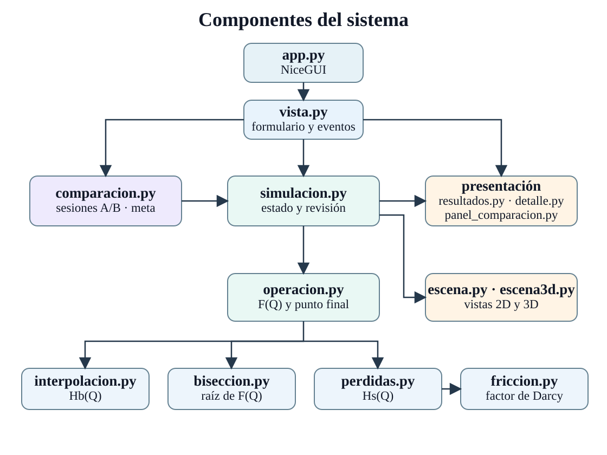
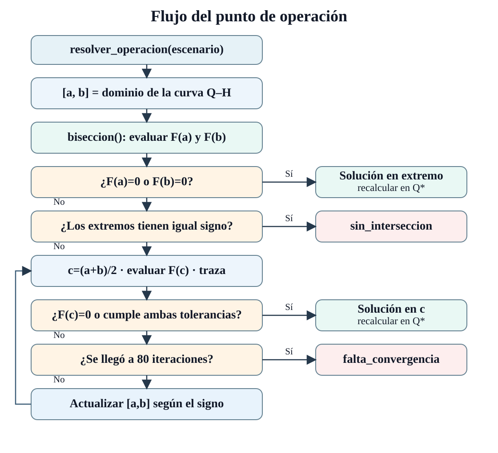
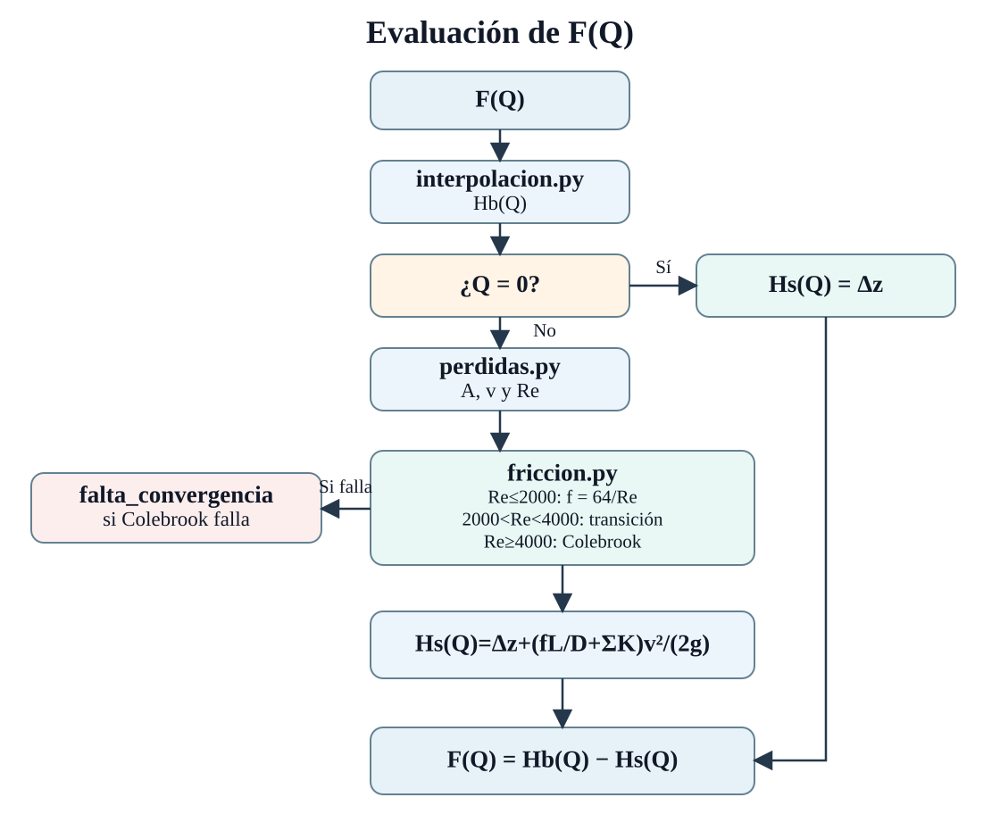
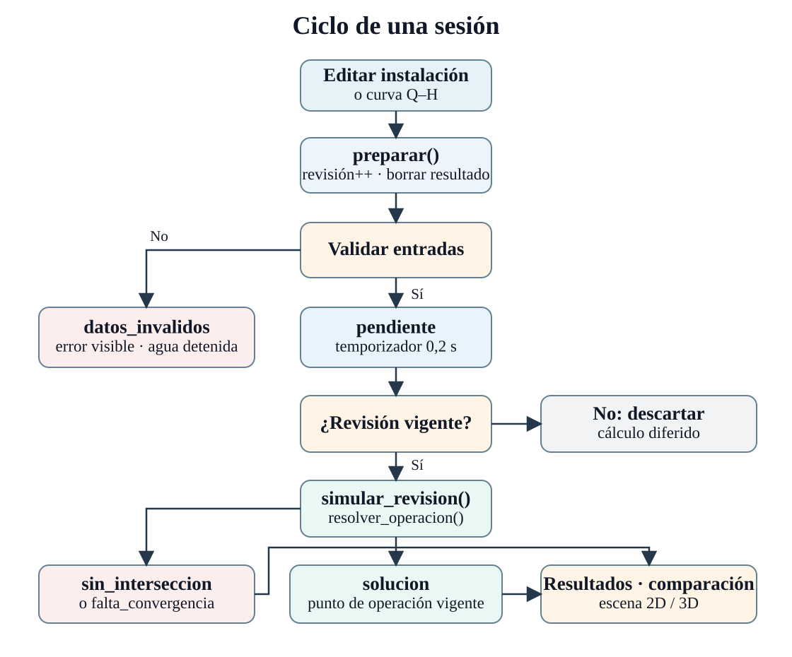

# PumpCalc

## Guía de estudio para la sustentación: Blender, escena 3D y rendimiento

Esta sección sigue el código que produce y presenta la vista 3D. Para explicarla en la sustentación, conviene separar **el modelo que se exporta una vez desde Blender** de **la escena que la aplicación construye al abrir un escenario**. Los archivos clave son [`generar_instalacion_base.py`](tools/blender/generar_instalacion_base.py), [`exportar_bomba_usuario.py`](tools/blender/exportar_bomba_usuario.py), [`escena3d.py`](pumpcalc/escena3d.py) y los componentes JavaScript de [`pumpcalc/assets/`](pumpcalc/assets/).

### 1. Qué hace Blender en este proyecto

Blender se usa como herramienta de preparación de modelos, **no como motor de la animación web**. Hay dos scripts con funciones diferentes:

| Script | Entrada y trabajo | Salida | Papel en la aplicación |
| --- | --- | --- | --- |
| [`generar_instalacion_base.py`](tools/blender/generar_instalacion_base.py) | Limpia la escena cargada en memoria y crea una instalación de referencia con suelo, dos depósitos, tuberías, bomba y rótulos. | `assets/modelos/referencia/instalacion_base.glb` | Sirve como base editable de referencia; la vista web no carga este archivo. |
| [`exportar_bomba_usuario.py`](tools/blender/exportar_bomba_usuario.py) | Abre el archivo Blender aportado, selecciona las mallas bajo `GRUPO / 04 Bomba` y la malla adicional llamada `Cylinder`, y ajusta sus acabados. | `assets/modelos/bomba_usuario.glb` | Es el modelo que carga la vista 3D web. |

El primer script agrupa los objetos en colecciones con nombres como `01 Suelo y bases`, `02 Depósito de succión` y `04 Bomba`. Usa cubos para bases y depósitos, cilindros para tramos rectos, superficies curvas para codos y materiales con color, transparencia, metalicidad y rugosidad. Sus fórmulas iniciales corresponden al **caso base**: longitud 40 m, diámetro 0,025 m y desnivel 12 m. Exporta en GLB, un archivo que reúne geometría y materiales. Sus rótulos y referencias de conexión son auxiliares de esa base.

El segundo script recorre la jerarquía de padres para identificar las piezas de la bomba; si no encuentra ninguna, termina con un error. Añade un bisel pequeño a ciertas mallas para suavizar cantos y ajusta `Metallic` y `Roughness` de sus materiales. Exporta **solo los objetos seleccionados**, con materiales y transformaciones aplicadas (`use_selection=True`, `export_apply=True`). Por eso el GLB final contiene la bomba, mientras que los depósitos y las tuberías variables se crean en la aplicación. Los dos scripts usan opciones distintas de orientación de ejes al exportar (`export_yup=True` en la referencia y `export_yup=False` en la bomba); son opciones del código para cada salida, no parámetros hidráulicos.

Desde la carpeta `PumpCalc`, los comandos documentados por los scripts son:

```bash
blender --background --python tools/blender/generar_instalacion_base.py
blender -b ../Untitled.blend --python tools/blender/exportar_bomba_usuario.py
```

El segundo comando requiere ese archivo `.blend` en la ruta indicada. La aplicación normal ya utiliza el GLB exportado y **no necesita abrir Blender** al iniciarse.

### 2. Cómo se configura y actualiza la escena web

En [`escena3d.py`](pumpcalc/escena3d.py), NiceGUI crea una `ui.scene` con dimensiones iniciales de 840 × 470, sin cuadrícula, con fondo `#080f2b`, cámara en perspectiva de 42° y objetivo de **30 FPS**. La cámara inicia en `(2.5, -11, 5.6)` mirando hacia `(0, 0, 1.28)`; «Restablecer cámara» vuelve a esa posición. El archivo `bomba_usuario.glb` se sirve en `/modelos/bomba_usuario.glb` y se inserta con `escena.gltf(...)`. También se colocan tres luces de acento, las etiquetas, el suelo, la base, ambos depósitos y la tubería.

La instalación visible se **reconstruye cuando cambia su geometría**. `geometria_3d(instalacion)` traduce las entradas a coordenadas de exhibición: el desnivel eleva el nivel de destino, la longitud desplaza el depósito de destino y el diámetro aumenta el radio dibujado. Las expresiones con logaritmos comprimen esos cambios para que quepan en pantalla; **no son una escala métrica**. La bomba GLB permanece como modelo fijo. La rugosidad y el coeficiente `K` intervienen en el cálculo hidráulico, pero esta función no los convierte en formas 3D.

Estas son las tres transformaciones exactas del código, con `L` y `Δz` en metros y `D` convertido a metros:

```text
altura visual de destino = 1 + 2,45 × ln(1 + Δz) / ln(101)
posición visual de destino = 3,9 + 0,42 × ln(1 + L/10) / ln(101)
radio visual de tubería = 0,082 + 0,052 × log₍₂₀₎(D/0,01)
```

Por ejemplo, duplicar `L` desplaza el depósito en pantalla, pero no duplica la distancia dibujada. El valor real de `L` sí entra en las ecuaciones hidráulicas; esta transformación solo decide la forma de mostrarlo.

La tubería se arma con cilindros rectos y codos de Bézier. Cada tramo muestra una envolvente exterior y un interior cian; se agregan dos `CanalAgua` para representar el movimiento dentro de aspiración y descarga. Los depósitos se construyen con base, postes, bordes y paneles transparentes. La escena usa un `SueloLuminoso` y materiales o shaders del navegador para los efectos visuales. Todo eso está definido en Python y en los archivos JavaScript de `pumpcalc/assets/`; no procede del GLB de la bomba.

**Cadena de datos que se puede explicar en voz alta:** entradas del escenario → cálculo del punto de operación → velocidad del agua `v` → `rapidez_3d(v) = 2,8v/(v + 1,8)` → movimiento visual. Esa rapidez se mide en **unidades visuales por segundo**, no en m/s: conserva la comparación entre escenarios, pero comprime la velocidad. Python envía al navegador el estado de flujo, pausa y revisión; los fotogramas del agua se animan allí mediante JavaScript, `performance.now()` y Three.js. `AguaEnTuberia` mueve 65 partículas por el recorrido; `CanalAgua` anima el patrón luminoso; `SuperficieAgua` baja el nivel de succión y `TanqueLlenado` sube el de descarga y dibuja el chorro.

El código hace coincidir **el volumen visual** que baja en succión con el que sube en descarga, usando las secciones dibujadas de ambos depósitos. La toma queda sumergida al final de la secuencia. El progreso del llenado ilustrativo aumenta con `dt × rapidez × 0,045` y se detiene al llegar a 1; este factor es de presentación, **no calcula un tiempo físico de llenado**. La solución hidráulica usa niveles de referencia fijos. «Pausar» detiene el avance visual; «Reproducir de nuevo» reinicia la secuencia. Si el caudal válido es cero, no hay movimiento; si no existe un punto vigente, se desactiva el flujo. El navegador debe poder mostrar WebGL para esta vista.

### 3. Cómo interpretar el análisis de tiempo y recursos

El archivo reciente [`tools/perfil_rendimiento.py`](tools/perfil_rendimiento.py) mide el **funcionamiento de la escena 3D del caso base**, no la duración de un cálculo hidráulico ni el tiempo de llenado. Inicia PumpCalc y Chromium, abre la página a 1440 × 900, espera a que la escena esté visible, deja pasar 2 segundos de estabilización y toma una muestra de 10 segundos por defecto. Reinicia el flujo cada 8 segundos para mantener la animación activa. En Linux lee `/proc` para sumar el servidor y el árbol de procesos de Chromium; el controlador Node de Playwright queda fuera de esa suma. El navegador informa el renderizador WebGL empleado.

En este equipo, el **12 de noviembre de 2026**, dos ejecuciones reales de 10 segundos en modo con ventana dieron:

| Medida | Corrida 1 | Corrida 2 | Lectura para la sustentación |
| --- | ---: | ---: | --- |
| FPS observados | 26,3 | 25,3 | Aproximadamente 25–26 actualizaciones por segundo durante estas muestras. El objetivo configurado es 30 FPS; no significa que siempre se alcance. |
| CPU promedio, servidor + Chromium | 47,5 % | 80,1 % | Consumo equivalente a 0,475 y 0,801 núcleos de CPU, respectivamente. Es porcentaje **de un núcleo**, no del procesador completo. |
| Memoria máxima PSS, servidor + Chromium | 587,3 MiB | 588,7 MiB | Pico aproximado de memoria física atribuible a esos procesos en cada muestra. No es tamaño del GLB ni memoria de la GPU. |

Las dos corridas informaron `ANGLE (Intel, Mesa Intel(R) Graphics (RPL-P), OpenGL 4.6)` como renderizador. **Interpretación de los FPS:** el perfilador registra las llamadas a `gl.clear` del lienzo WebGL y divide los intervalos registrados por el tiempo entre la primera y la última llamada. Es una aproximación a la frecuencia de actualización: 26,3 FPS equivalen a unos **38,0 ms por actualización**, y 25,3 FPS a unos **39,5 ms**. Con un objetivo de 30 FPS, el intervalo ideal sería 33,3 ms. Esta prueba muestra una escena animada cercana, aunque inferior, a ese objetivo en este equipo; no demuestra fluidez constante ni da los peores tiempos de cada fotograma.

**Interpretación de CPU y memoria:** la CPU sale de la diferencia de tiempo de procesador acumulado en `/proc`, dividida por los segundos transcurridos. Puede superar 100 % si varios núcleos trabajan a la vez. La diferencia entre 47,5 % y 80,1 % muestra variación entre ejecuciones; no conviene presentarla como un consumo fijo. PSS reparte entre procesos la memoria de páginas compartidas y se consulta aproximadamente cada 0,25 segundos; el valor mostrado es el máximo observado, de modo que un pico más breve podría no quedar capturado. Estos números dependen del equipo, el renderizador, la carga del sistema, el tamaño de ventana y el modo de ejecución.

Para repetir la medición en Linux, con Chromium, una sesión gráfica y Playwright disponibles, ejecuta desde `PumpCalc`:

```bash
.venv/bin/python tools/perfil_rendimiento.py --segundos 10
```

`--headless` permite ejecutarlo sin ventana, pero puede cambiar el renderizador y volver las cifras no comparables con las anteriores. La conclusión defendible es: **en estas dos muestras del caso base, la animación 3D rondó 25–26 FPS, usó menos de un núcleo de CPU en promedio y ocupó cerca de 588 MiB PSS entre servidor y navegador**. El script no mide arranque, latencia al editar entradas, duración del solucionador, consumo de GPU ni tiempo real de traslado del agua.

## Acerca de PumpCalc

PumpCalc es un simulador web local escrito en Python. Estima cuánto caudal entrega una bomba a través de una tubería entre dos depósitos abiertos. Puedes cambiar una condición de la instalación, comparar dos escenarios y ver tanto el movimiento del agua como los pasos del cálculo.

## Estructura del proyecto

| Carpeta | Contenido |
| --- | --- |
| `pumpcalc/` | Cálculo e interfaz web; `pumpcalc/assets/` contiene las animaciones 3D. |
| `assets/modelos/` | Modelo GLB que usa la vista 3D; `referencia/` conserva la base anterior. |
| `tools/blender/` | Scripts para generar o exportar los modelos, fuera de la aplicación en ejecución. |
| `tests/` | Pruebas de la app web y del cálculo; `legacy/` reúne las de escritorio. |
| `docs/` | Guías y documentación; `antecedentes/` guarda los documentos iniciales. |

`app.py` inicia la aplicación web. `main.py` conserva la entrada de escritorio anterior.

## Instalación en Windows

Necesitas Python 3.13.7, la versión verificada para este proyecto, y un navegador. Abre PowerShell en la carpeta de PumpCalc y ejecuta estos comandos. El primero crea el entorno virtual. El segundo instala NiceGUI y pytest con las versiones indicadas en [requirements.txt](requirements.txt).

```powershell
python -m venv .venv
.\.venv\Scripts\python.exe -m pip install -r requirements.txt
.\.venv\Scripts\python.exe app.py
```

Con el servidor en ejecución, abre <http://127.0.0.1:8080> en el navegador. Para detenerlo, pulsa `Ctrl+C` en la terminal. En las siguientes sesiones puedes arrancar con el tercer comando.

## Ejecutar con Docker

Desde la carpeta de PumpCalc:

```bash
docker compose up --build
```

Abre <http://localhost:8080>. Para detenerlo, pulsa `Ctrl+C`; para retirar el contenedor, ejecuta `docker compose down`. También puedes construir y ejecutar sin Compose con `docker build -t pumpcalc .` y `docker run --rm -p 8080:8080 pumpcalc`.

## Primer experimento

1. Abre el **Caso base** en A. La tubería mide 40 m, su diámetro interno es de 25 mm y el desnivel es de 12 m. El caudal estimado es de aproximadamente 3,765450 m³/h.
2. Pulsa **Copiar A en B**, cambia el diámetro de B a 32 mm y activa **Comparar A y B**. Espera el recálculo automático o pulsa **Simular**.
3. Compara las cifras y las escenas. El selector **3D / 2D** cambia ambas vistas sin alterar el cálculo. En 3D puedes girar la instalación y restablecer la cámara. En B pasan unos 4,381752 m³/h, pero el agua avanza a 1,513406 m/s frente a 2,130809 m/s en A. El área de la tubería crece más que el caudal, así que la velocidad disminuye.
4. Vuelve a copiar A en B y cambia únicamente la longitud a 80 m. El recorrido dibujado se alarga y las trazas se ralentizan. También puedes cambiar el desnivel para mover el depósito de destino, o cambiar la rugosidad y K para observar las pérdidas indicadas en la escena.
5. Abre **Detalle numérico** para ver el tramo de interpolación, el residuo y la cota de bisección, y las iteraciones de Colebrook cuando correspondan. Carga **Sin intersección** en B para ver cómo se presenta un caso sin cruce dentro del intervalo de la curva de la bomba.

La curva de demostración es ficticia. El cálculo hidráulico es estacionario y usa niveles de referencia fijos. La vista 2D mantiene esos niveles; la 3D muestra una transferencia ilustrativa: baja el nivel en succión y sube en descarga, con rapidez relativa dependiente de la velocidad calculada. «Reproducir de nuevo» restablece la secuencia. Los niveles mostrados y la parada visual no predicen un tiempo de llenado ni una parada física de la bomba. Si Q = 0 hay solución sin movimiento; si faltan datos válidos o no hay cruce, se suspende el movimiento sin suponer Q = 0. La vista 3D requiere WebGL en el navegador. A y B se guardan en memoria mientras la página está abierta.

En «Curva de la bomba» puedes anotar opcionalmente la potencia nominal del motor (HP), la altura máxima Hmax (m) y el caudal máximo Qmax (m³/h). Son datos de referencia independientes para A y B: se copian con «Copiar A en B» y se muestran en la comparación. No sustituyen los pares caudal–altura ni modifican el cálculo. Hmax y Qmax no representan un mismo punto de funcionamiento.

## Cómo funciona el cálculo

1. [entradas.py](pumpcalc/entradas.py) valida los datos y convierte milímetros a metros y m³/h a m³/s. Así, las ecuaciones reciben unidades coherentes. La curva exige caudales crecientes y alturas que no aumenten.
2. [interpolacion.py](pumpcalc/interpolacion.py) calcula la altura de la bomba `Hb(Q)` en el segmento que contiene el caudal. Por ejemplo, entre 2 m³/h a 31 m y 3 m³/h a 26 m, la altura para 2,5 m³/h es 28,5 m.
3. [perdidas.py](pumpcalc/perdidas.py) calcula el área, la velocidad y Reynolds. Suma el desnivel y las pérdidas de tubería y accesorios para obtener `Hs(Q)`. [friccion.py](pumpcalc/friccion.py) obtiene el factor de Darcy mediante `64/Re` en régimen laminar, punto fijo de Colebrook en turbulento y una unión didáctica en transición.
4. [operacion.py](pumpcalc/operacion.py) usa [biseccion.py](pumpcalc/biseccion.py) para encontrar dónde `Hb(Q) − Hs(Q) = 0` dentro del intervalo de la curva. Para aceptar una raíz aproximada se exige un semiancho de hasta `1e-7 m³/s` y un residuo de hasta `1e-4 m`. El resultado conserva las iteraciones y el tramo que usó el interpolador para calcular la altura de la bomba.

### Ejecutar el motor desde Python

Abre `.\.venv\Scripts\python.exe` desde la raíz y pega este ejemplo en el intérprete.

```python
from dataclasses import replace

from pumpcalc.ejemplos import caso_base
from pumpcalc.operacion import resolver_operacion

base = caso_base()
tuberia_ancha = replace(
    base, instalacion=replace(base.instalacion, diametro_m=0.032)
)

for nombre, escenario in (("A", base), ("B", tuberia_ancha)):
    resultado = resolver_operacion(escenario)
    punto = resultado.punto
    if punto is None:
        print(f"{nombre} | {resultado.mensaje}")
        continue
    print(
        f"{nombre} | Q = {punto.caudal_m3s * 3600:.6f} m³/h"
        f" | H = {punto.altura_m:.6f} m"
        f" | v = {punto.sistema.velocidad_ms:.6f} m/s"
    )
```

```text
A | Q = 3.765450 m³/h | H = 20.641853 m | v = 2.130809 m/s
B | Q = 4.381752 m³/h | H = 15.564232 m | v = 1.513406 m/s
```

Aquí `replace` crea un segundo escenario a partir de A, con el diámetro expresado en metros. El motor devuelve `punto=None` cuando no hay una solución dentro del dominio o falla la convergencia. Un resultado válido con caudal cero sí tiene un punto.

## Cómo se conecta la interfaz

| Parte | Dónde leer el código | Qué resuelve |
| --- | --- | --- |
| Arranque y vista | [app.py](app.py), [vista.py](pumpcalc/vista.py), [tema.py](pumpcalc/tema.py) | Abren NiceGUI y conectan el formulario con los resultados. |
| Edición y comparación | [simulacion.py](pumpcalc/simulacion.py), [comparacion.py](pumpcalc/comparacion.py), [ejemplos.py](pumpcalc/ejemplos.py) | Conservan entradas independientes por escenario y recalculan tras 200 ms sin cambios válidos. La meta se compara con el caudal calculado. |
| Resultados y gráficas | [resultados.py](pumpcalc/resultados.py), [presentacion.py](pumpcalc/presentacion.py), [detalle.py](pumpcalc/detalle.py), [panel_comparacion.py](pumpcalc/panel_comparacion.py) | Presentan el resultado vigente y las iteraciones. La vista individual y la comparación comparten la preparación de las curvas. |
| Animación | [animacion.py](pumpcalc/animacion.py), [escena.py](pumpcalc/escena.py), [escena3d.py](pumpcalc/escena3d.py), [animaciones](pumpcalc/assets), [modelo 3D](assets/modelos/bomba_usuario.glb) | La vista 2D mueve trazas desde Python. La vista 3D dibuja agua, bomba y depósitos con Three.js y anima el flujo en el navegador según la velocidad calculada. |
| Versión de escritorio anterior | [main.py](main.py), [pumpcalc/ui/](pumpcalc/ui/), [casos_uso.py](pumpcalc/casos_uso.py), [hydraulics.py](pumpcalc/hydraulics.py), [persistencia.py](pumpcalc/persistencia.py) | Usa CustomTkinter, calcula dos condiciones del tanque mediante Hazen–Williams y guarda escenarios en SQLite. |

## Pruebas

```powershell
.\.venv\Scripts\python.exe -m pytest
```

La carpeta [tests](tests/) cubre casos numéricos de referencia, validación, estados de A/B, escena y eventos de NiceGUI. Con las dependencias web, pytest omite el módulo de pruebas de la ventana de escritorio si falta CustomTkinter.

## Documentación y comprobaciones

- [Manual, modelo y tutorial del motor](docs/README.md).
- [Guía de sustentación](docs/GUIA_SUSTENTACION.md).
- [Informe de verificación y aceptación manual](docs/VALIDACION_FINAL.md).
- [Registro de desarrollo](docs/avance.md).

## Diagramas del código

### Componentes del sistema



### Flujo del punto de operación



### Evaluación de F(Q)



### Ciclo de una sesión


