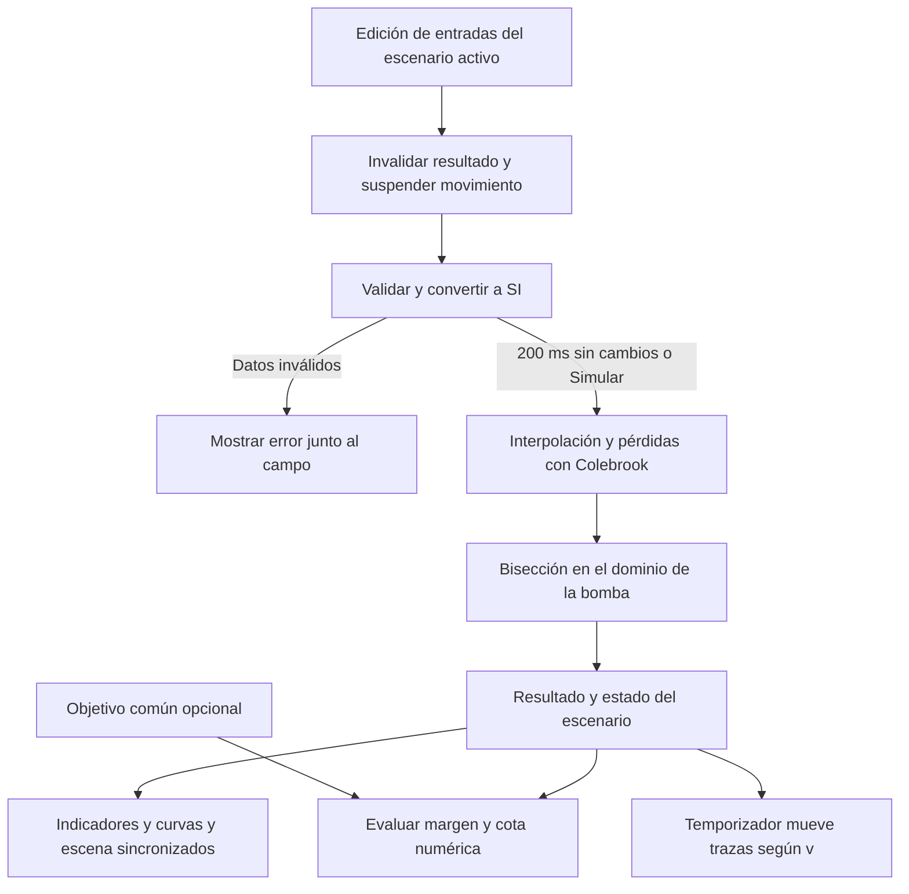

# PumpCalc flujo arquitectura e interfaz

**Estado documental:** especificación vigente, sincronizada el 10 de noviembre de 2026. Describe la entrega requerida; no certifica que el código existente ya la implemente.

Fuentes de verdad: [propuesta v4](../Baseline%20y%20pasos/PumpCalc%20propuesta%20v4.docx), [línea base con animación](../Baseline%20y%20pasos/PumpCalc_linea_base_Codex_con_animacion.md) y [plan de desarrollo por pasos](../Baseline%20y%20pasos/PumpCalc_plan_de_desarrollo_por_pasos.md). La propuesta y la línea base fijan el producto y los cálculos; el plan establece el orden de implementación y verificación. Los documentos de `docs` desarrollan esas fuentes y no las sustituyen.

## Arquitectura requerida

La aplicación será una web local de NiceGUI escrita en Python. El servidor escuchará en `127.0.0.1`. Se separarán validación y conversión de unidades, interpolación, fricción, pérdidas, bisección, datos de ejemplo, estado de escenarios y presentación. La distribución concreta en archivos se decidirá al implementar; no se exige conservar la estructura anterior.

El motor recibirá datos de Python, sin controles de interfaz, y devolverá resultados, estados y trazas. Cada escenario tendrá su propia copia de entradas, resultados y trazas en memoria. La meta será común a A y B y se evaluará fuera de la resolución hidráulica. No se incluye persistencia en SQLite, cuentas ni biblioteca de escenarios guardados.

## Composición de la vista

Una vista principal en español contendrá formulario de instalación, tabla editable de bomba, escena animada, indicadores, gráfica y detalle numérico desplegable. A y B se elegirán mediante pestañas o controles equivalentes. No habrá páginas independientes por función ni navegación obligatoria de la versión anterior.

| Elemento | Comportamiento requerido |
| --- | --- |
| Formulario | L en m, D en mm, Δz en m, ε en mm y K sin unidad; errores junto al dato afectado. |
| Curva de bomba | Entre 3 y 10 pares Q en m³/h y H en m, sin corrección silenciosa de orden o duplicados. |
| Acciones | Simular, copiar A en B, cargar ejemplo en el escenario activo, pausar y reanudar animación. |
| Indicadores | Q, H, v, pérdidas en tubería y accesorios, Re, f de Darcy y régimen. H expresa altura de energía, no presión medida. |
| Gráfica | `ui.echart` configurado en Python, ejes numéricos Q y H, puntos de bomba, interpolación, sistema y marcador del cruce. |
| Detalle | Iteración, a, b, c, F(c) y semiancho antes de dividir el intervalo; tolerancias, residuo y total de iteraciones. |
| Fricción | Tramo interpolado y régimen; traza de punto fijo solo del resultado final, auxiliar f₄₀₀₀ en transición y sin iteración en laminar. |
| Comparación | Dos escenas compactas con Q, v y D, curvas superpuestas y tabla de entradas y resultados. Cada curva mantiene su propio dominio. |
| Meta | Objetivo opcional común, margen y estado; no modifica la solución. |

La gráfica utilizará 150 muestras por escenario; el motor resolverá el cruce mediante F, no mediante proximidad entre puntos dibujados. Se mostrará la diferencia de caudal entre B y A y su porcentaje respecto de A. Si Q de A es cero, el porcentaje será no aplicable. Si un escenario no tiene solución vigente, no se fabricará una comparación numérica.

## Recorrido principal

1. Abrir el caso base, calculado y animado, con datos ficticios identificados.
2. Editar una condición y observar el recálculo; Simular lo ejecuta de inmediato.
3. Copiar A en B y modificar B sin alterar A.
4. Comparar curvas, cifras y movimiento con la misma escala visual.
5. Consultar métodos y trazas para explicar el resultado.
6. Cargar el ejemplo sin intersección y observar curvas, aviso y escena detenida.

## Estados de cálculo y presentación

| Estado | Resultado y movimiento |
| --- | --- |
| Datos inválidos | Señalar el problema y suspender el movimiento; el resultado anterior no es vigente. |
| Cálculo pendiente | Mostrar pendiente y suspender movimiento hasta disponer del nuevo resultado. |
| Solución encontrada | Mostrar el resultado vigente y mover las trazas según v, salvo pausa visual o Q = 0. |
| Ausencia de intersección | Mantener curvas y explicar si la bomba queda por encima o debajo dentro del dominio disponible; sin caudal inventado. |
| Falta de convergencia | Informar el fallo del método, incluido Colebrook, y suspender movimiento; no confundirlo con falta de cruce. |

Pausar es un control visual independiente del estado hidráulico. Editar cualquier entrada del modelo invalida solo el escenario afectado. Cambiar únicamente el objetivo actualiza la evaluación de la meta. Recargar restaura el ejemplo inicial.
## Animación 2D del agua

### Representación visible

La escena mostrará agua azul dentro de una tubería llena y pequeñas trazas o partículas que recorran continuamente su interior desde el origen hasta el destino. El movimiento deberá ser perceptible durante el uso, sin depender de una imagen o un video precalculado. La tubería será más ancha al aumentar el diámetro; longitud y desnivel aparecerán rotulados en un esquema que no estará a escala geométrica.

Los niveles de los depósitos permanecerán fijos. La animación representará el flujo estacionario calculado, sin simular el llenado de tanques ni el arranque físico de la bomba. Se utilizará una escena prediseñada, sin editor de circuitos, dibujo libre, simulación 3D ni dinámica computacional de fluidos.

### Movimiento vinculado al modelo

Las trazas avanzarán según la velocidad media v obtenida de Q y del área de la tubería. No se asignará una rapidez visual arbitraria a cada ejemplo. Para mantener el movimiento legible se usará una escala ilustrativa común a ambos escenarios:

$$
s(v) = 240\frac{v}{v+2}
$$

En esta expresión, v se introduce en m/s; 2 representa una velocidad de referencia de 2 m/s y 240 el límite visual en píxeles por segundo. Así, s vale cero cuando v es cero, aumenta continuamente con v y comprime las velocidades grandes. Los indicadores conservarán Q y v en sus unidades físicas. La escena indicará **Movimiento ilustrativo**, sin atribuir una escala física al recorrido en pantalla.

La misma relación se aplicará a A y B, sin normalizar cada escena por separado. Un mayor caudal no implica necesariamente mayor velocidad: al aumentar el diámetro puede crecer Q y disminuir v. La animación deberá reflejar esa diferencia; no cambiará las revoluciones de la bomba, que se modela a velocidad fija.

### Interacción y estados

Después de 200 ms sin cambios en entradas válidas del modelo se recalculará el escenario activo. La animación, las curvas y los indicadores tomarán juntos el nuevo resultado. **Simular** ejecutará ese cálculo inmediatamente. Un temporizador de NiceGUI actualizará desde Python solo la capa de trazas con el resultado vigente. Modificar solo el caudal objetivo actualizará la evaluación de la meta.

Habrá un control **Pausar animación** y **Reanudar animación**. La pausa será solo visual: no apagará la bomba ni modificará los resultados. Si hay datos inválidos, cálculo pendiente, falta de convergencia o ausencia de cruce, se suspenderá el movimiento y se mostrará el estado correspondiente. La ausencia de solución no se convertirá en un supuesto caudal cero. Una solución válida con Q = 0 se representará sin movimiento.

Al comparar se mostrarán dos vistas compactas de la misma escena, con las etiquetas de Q, v y D. Copiar A en B producirá inicialmente el mismo movimiento; al modificar B, A conservará su configuración y resultado. El usuario podrá ver qué cambia sin perder la referencia inicial.

La escena se implementará con `ui.interactive_image`, con una capa para la instalación y otra para las trazas. `ui.timer` actualizará desde Python la capa de trazas según el tiempo transcurrido, como exige el paso 7.

## Verificación de la interfaz

Los pasos 5 a 8 del plan incorporan formulario, curvas, animación y comparación, respectivamente. Cada cambio de interfaz se comprobará iniciando `python app.py` y recorriendo el comportamiento nuevo en el navegador. El paso 9 verificará el recorrido completo en un entorno limpio. Las decisiones visuales menores se resolverán con criterio propio sin reducir estos requisitos.

La base matemática está en [Documento del proyecto](DOCUMENTO_PROYECTO.md), la aceptación completa en [Caso de finca y validación](CASO_FINCA_Y_VALIDACION.md) y las decisiones cerradas y pendientes en [Pendientes de diseño](PENDIENTES_DE_DISENO.md).
